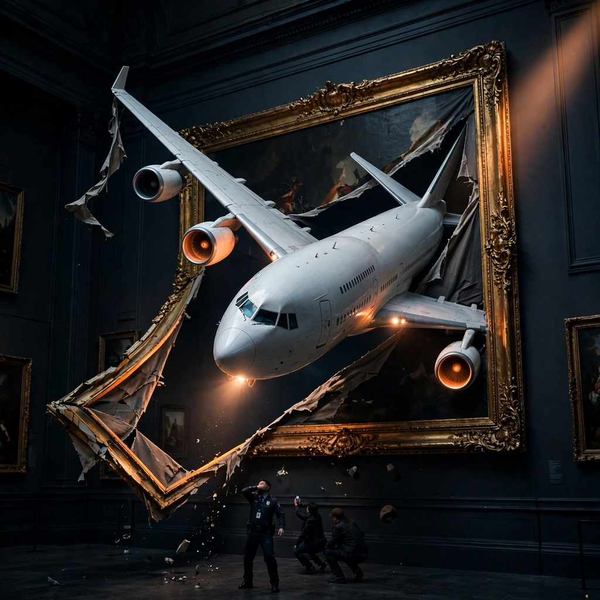

# First Class

[](https://make.fun)
[](https://make.fun)
[](https://make.fun)

A jumbo jet bursts out of a torn painting — an entry for the [make.fun](https://make.fun) `ai-excited-01` competition ("Make the AI judge excited").



## Run

```sh
python3 main.py
```

`main.py` validates `entry.png` (JPEG SOI/EOI markers, dimensions at most 1024×1024, size at most 1 MiB) and copies it to `output.png`.
